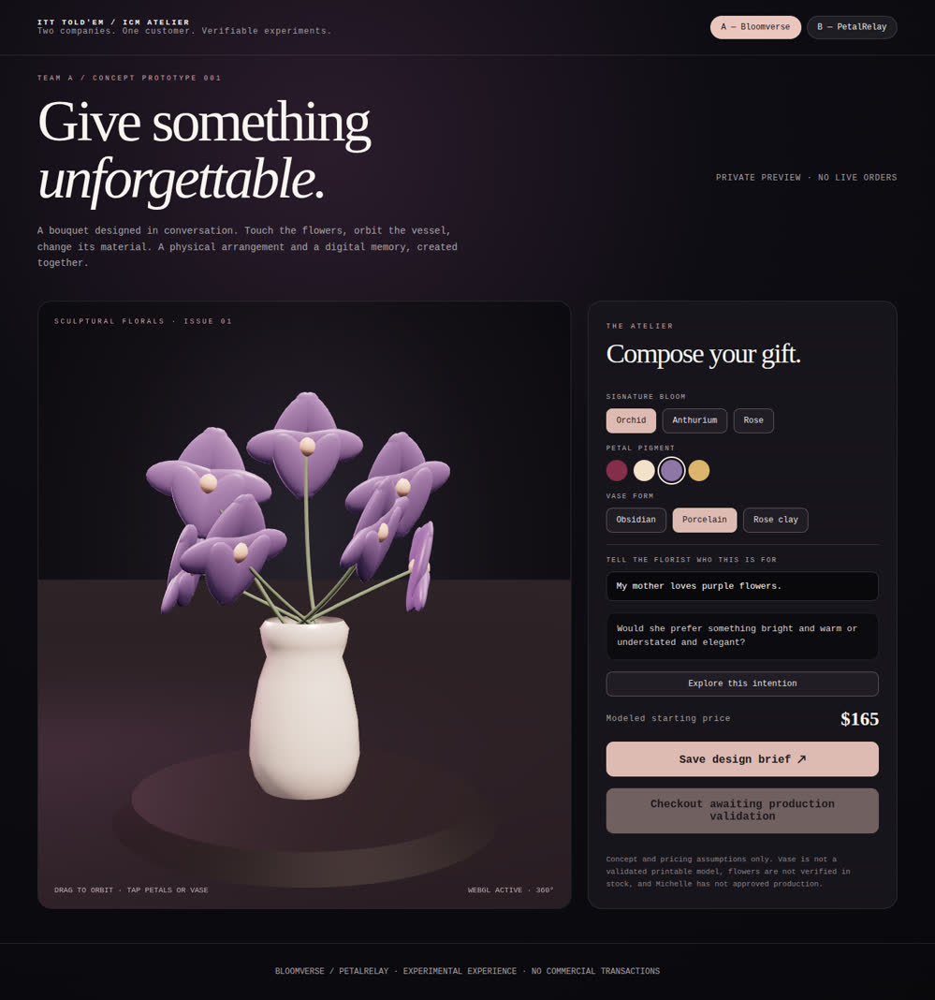
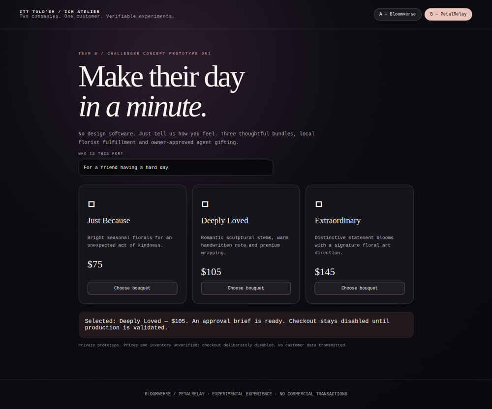

# Bloomverse: two flower companies, one unfinished scoreboard

**A public field journal by Lloyd Cobb Jr.**  
Filed November 15, 2026 · Engineering / commerce / interactive media

Two teams showed up with the same assignment: make gifting flowers better.

One took the scenic route. **Bloomverse** began with a 360-degree bouquet, a vase that changes material, and the possibility of building an arrangement through conversation. The other, **PetalRelay**, took a shorter route: describe the moment, choose a gift, and get to approval.

This is not a press release announcing two successful companies. It is a report on a controlled experiment, with enough evidence for a reader to see what's real—and enough restraint to acknowledge what isn't.

| Bloomverse: interactive 3D prototype | PetalRelay: text-first challenger |
|:--|:--|
|  |  |

*Both images are browser-test captures of locally running prototypes. They show interfaces—not a live shop, finished manufacturing pipeline, or paid sales.*

## From the first sprint

| What I checked | What the evidence says |
|---|---|
| Team assignment | 2 teams, 10 roles each |
| Execution | 20 deterministic role-workers; **zero** independent AI-model agents |
| Python checks | **17 passed, 0 failed** |
| Browser prototype | 3D initialized; petals and vase changed; scripted prompt responded |
| Rival prototype | One buyer could choose a gift and generate an approval-only selection |
| Real orders, customers, deliveries | **Zero** |
| Schedule | Four three-hour windows/day configured; only opening kickoff verified when this dispatch was filed |

A browser test also timed two **different scripted paths**: 4.104 seconds for a six-action Bloomverse design-brief export, versus 1.735 seconds for a three-action PetalRelay selection. That is **not** a valid conversion comparison. The competitor's task was shorter. Calling that a win would be like comparing a warm-up lap to the full game.

[Read the opening field dispatch](./dispatches/2026-11-15-opening-whistle.md) · [Inspect the public evidence](./evidence/sprint-01.json) · [Run the independent public-data check](./proof/verify_public_receipt.py)

## What's on the beat

**Design.** Can a mobile shopper actually touch a flower, orbit the bouquet, and personalize it without getting lost in the theater?

**Commerce.** Can someone buy the gift after the design changes? At what real price, with whose inventory, and who will fulfill the order?

**Agents.** Can an AI assistant prepare a meaningful gift without ever stepping over the buyer's authorization?

**Competition.** Which company wins on observed customer results—not on a hypothetical scorecard?

The next gates require an actual iPad usability session, a validated vase production file, a florist-approved production packet, a Shopify test order and genuine user evidence.

## See the work. Not the secret machinery.

I am publishing the questions, decisions, dated results, failures, and non-sensitive verification utilities. The commercial orchestration, unreleased agent methods, private prompts, storefront internals, credentials, unpublished visual assets, and supplier information remain private. This is deliberate. **A public engineering record is not a source-code donation.**

[The publication boundary](./RIGHTS_AND_DISCLOSURE.md) · [Editorial evidence rules](./METHOD.md)

If you are recruiting, evaluating technical judgment or following this project, you will see the part of engineering that polished launches tend to hide: the moment the test tells you the idea still has work to do.

*Field notes © 2026 Lloyd Cobb Jr. All rights reserved. No open-source license is granted for this project.*
